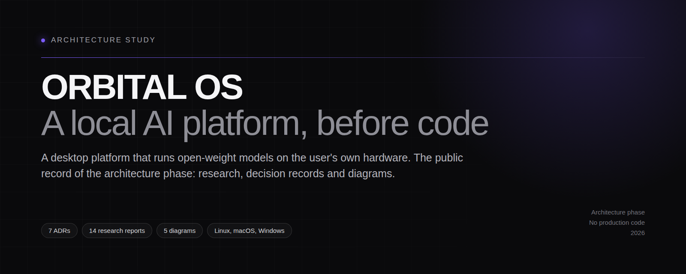
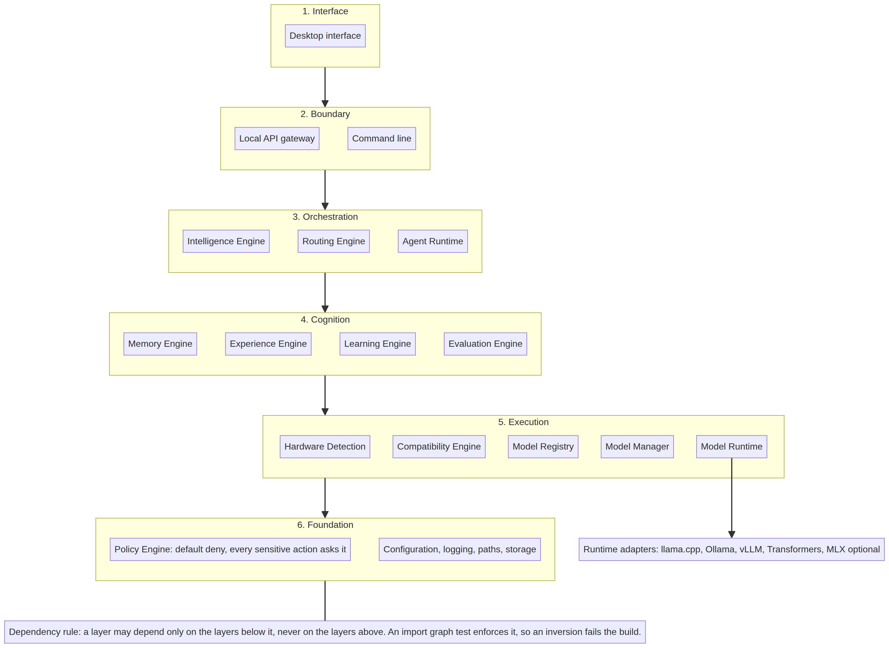

# ORBITAL OS
[English](README.md) · [Português](README.pt-BR.md)

An architecture study for a local, hardware-agnostic AI platform delivered as a desktop application.



ORBITAL OS is a real product in its architecture phase, built for the ORBITAL hardware line and for
general AMD, NVIDIA, Intel and CPU machines. This repository is the public record of that phase:
research, architecture, decision records and diagrams. It contains no production code, and it claims
no hardware compatibility that has not been tested on the matching machine.

## Overview

ORBITAL OS is a local, modular, cross-platform AI platform distributed as an application for Linux,
Windows and macOS. It runs models on the user's own hardware, with privacy as the default setting,
and it exposes an engine of its own with persistent memory, an experience record, continuous
learning, quality evaluation, model management and, later, multi-agent execution. It is not an
operating system. It is the application that runs on the ORBITAL hardware line, whose machines are
built on AMD Ryzen AI Max platforms ([orbitalzerion.com](https://www.orbitalzerion.com/en/)), and it
is designed to run on other vendors' hardware as well. The same core has to work on AMD, NVIDIA,
Intel and plain CPU, on three operating systems, using whichever inference runtime suits the machine
in front of the user.

The audience for this study is engineers and technical reviewers who want to see how a
hardware-agnostic inference product is specified before code exists: which claims are provable, which
are borrowed from third parties, and which remain unverified. State at the close of the architecture
phase: 57 files, approximately 4,000 lines of documentation, 14 research reports, 7 decision records
and 5 diagrams. No production code. No compatibility claimed without a hardware test.

## The problem

A local inference product has to answer three questions before it can run anything: what hardware is
actually present, which runtime can use that hardware, and whether a given model fits in memory.
Each question has an answer that is easy to ship and wrong.

Hardware is described by marketing sheets, not by the operating system. A vendor page may list one
memory ceiling while the machine on the bench reports another, and public benchmarks are usually
produced on a configuration that differs from the one being sold. Software that trusts the spec sheet
either refuses models that would have fit or accepts models that exhaust memory halfway through a
conversation. The same trap exists for acceleration: a device name is not a capability, and a
nominal TOPS figure says nothing about whether a model in a given format can execute on that unit.

Runtimes are equally fragmented. No single inference runtime covers AMD, NVIDIA, Intel, Apple and
plain CPU across Linux, Windows and macOS with the same guarantees, and each one is strong in a
different corner. Committing the product to one runtime commits the product to one vendor's roadmap.

Finally, the feature that makes the product interesting is the one most likely to break trust.
"Learning from your use" implemented as training on the base model removes the ability to roll back,
the ability to delete, and the ability to explain why the system changed its behaviour.

## What the product does

**Assess the machine and the model.** Hardware detection inventories the operating system, CPU,
graphics devices, memory and acceleration libraries, then runs a short functional test per
acceleration API instead of trusting a device name. The compatibility engine turns that inventory
into a memory budget and one of six explicit states per model, from tested to incompatible.

**Acquire and run models.** A registry separates discovery from installation from execution, with
provenance for every metadata field. The model manager downloads from official sources with checksum
verification, and a universal runtime layer executes the artifact through whichever adapter suits
the machine.

**Remember.** A memory engine keeps episodic, semantic, procedural and preference memories in a local
store with hybrid retrieval, origin tracking, configurable retention, and deletion that reaches every
derived artifact.

**Improve, with a gate.** Quick learning adjusts reversible artifacts such as preferences, context
instructions, procedures and routing. Deep learning produces versioned adapters over a frozen base
model, evaluates them against the current version, and promotes only on demonstrated improvement,
with rollback available at any time.

**Expose the engine.** The same core is usable as an importable library, as a command line tool, and
as a local API with a declared OpenAI-compatible subset, so external clients and the desktop
interface are both ordinary consumers.

**Act through agents.** A later scope adds an agent runtime with its own contracts, tool execution
under policy, and per-agent model choice. This part is specified, not built.

## Architecture



Six layers, fifteen modules, one dependency rule: a layer may depend only on the layers below it, and
an inversion fails the test suite rather than a code review. Source: [diagrams/architecture.mmd](diagrams/architecture.mmd).

| Layer | Modules | Responsibility |
| --- | --- | --- |
| Interface | Desktop interface | Presents state, collects consent, never owns canonical data |
| Boundary | API gateway, command line | Declared OpenAI-compatible subset, streaming, local authentication |
| Orchestration | Intelligence Engine, Routing Engine, Agent Runtime | Interprets the request, chooses model and runtime, runs agents |
| Cognition | Memory Engine, Experience Engine, Learning Engine, Evaluation Engine | Retrieval, selective recording, adapters and their gate, scoring |
| Execution | Hardware Detection, Compatibility Engine, Model Registry, Model Manager, Model Runtime | Inventory, verdicts, catalog, artifacts, adapters |
| Foundation | Policy Engine, configuration, logging, storage | Default-deny decisions, audit trail, local persistence |

A request arrives at the boundary, is checked by the policy engine, and reaches the Intelligence
Engine, which resolves intent, complexity and a context budget. The Memory Engine returns consented
context with origin attached. The Routing Engine picks a model, a runtime and a fallback chain, using
a compatibility verdict as input. The runtime adapter loads the artifact, generates with streaming,
and reports metrics. The response leaves through the boundary with its execution record, while the
Experience Engine records the interaction only if consent exists, and the learning queue stays off
the request path. The sequence is drawn in [diagrams/flow.mmd](diagrams/flow.mmd).

## Engineering highlights

### Sizing models from the memory the runtime reports

The problem: vendor documentation, benchmark articles and the machine in front of the user disagree
about how much memory exists, and a model that is accepted on paper can exhaust memory during
generation. The decision: the compatibility engine sizes every candidate against memory the operating
system reports at runtime, plus the result of a functional test per acceleration API, never against a
nominal specification. The budget is explicit: resident weights from total parameters and effective
bits per weight, a KV cache from the artifact's own layer and head metadata, scratch space, and a
reserve of 20 to 25 percent of memory for the system with 10 to 15 percent of the inference budget
for overhead. The verdict is one of six states, and only a recorded environment test can produce
"tested". The trade-off: the software stays correct on hardware nobody qualified, which also means it
answers "compatible, not validated" where a marketing page would prefer "supported". The product
cannot promise that a model runs on a machine it has not seen, because the honest answer depends on
that unit's reported memory.

### One core, several runtimes, with capabilities declared

The problem: no runtime covers AMD, NVIDIA, Intel, Apple and CPU on three operating systems, and
wrapping the application around one of them imports that vendor's limits into the product. The
decision: a runtime contract with discovery, installation, load, configure, generate, embed, status,
metrics and diagnose, implemented once per adapter for llama.cpp, Ollama, vLLM, Transformers and,
optionally, MLX. Capabilities are declared per method. An adapter that cannot implement a method
faithfully states the limitation and the call fails loudly; simulating the behaviour is treated as a
test failure. Selection belongs to the routing engine, with the compatibility verdict as input, never
to the caller. The trade-off: every adapter carries its own validation matrix per operating system,
backend and device, so maintenance cost scales with the number of adapters kept alive. A short list of
well-tested adapters is worth more than broad nominal coverage, and an adapter nobody tests gets
disabled rather than patched into the contract.

### Learning that cannot corrupt the base model

The problem: "it learns with you" implemented as training on the base model destroys rollback,
deletion and auditability, and it degrades silently. The decision: two layers with different
privileges. Quick learning writes only reversible, human-readable artifacts: preferences, context
instructions, memories, procedures and routing configuration. Deep learning produces LoRA, QLoRA or
DoRA adapters over a frozen base, trained in isolation from an immutable versioned dataset, scored
before and after with paired comparison, and promoted only when improvement is demonstrated. Every
adapter has lineage, a version history, a current and previous pointer, and rollback. Automatic
promotion is prohibited by default. The trade-off: the achievable improvement is bounded by what
adapters deliver, and the Evaluation Engine becomes a prerequisite instead of an accessory. A single
interaction can never cause a permanent change, which makes the product slower to adapt than the
promise suggests. Deletion also has to reach derived adapters, not only stored text.

### Default-deny for local autonomy

The problem: agents and tools run with the user's own credentials on the user's own machine, so a
permissive default is a local privilege escalation waiting for a bad tool description. The decision:
the policy engine sits in the foundation layer and every sensitive action asks it. Default is deny,
privilege is minimal, inheritance never amplifies, approvals bind payload, resource, tool and
validity, and the audit trail is append-only with revocation. Isolation uses what each operating
system actually provides, seccomp with Landlock, AppContainer with job objects, or App Sandbox, and it
fails closed with a visible message when the platform cannot deliver the protection requested. MCP is
an interoperability boundary, not a trust authority. The trade-off: more approval prompts, features
unavailable on platforms without the isolation primitive, and an interface obligation to state which
protection was actually applied rather than which one was intended.

## Tech stack

| Layer | Choice | Why |
| --- | --- | --- |
| Core language | Python 3.12 with uv | The only ecosystem where llama.cpp, Ollama, vLLM, Transformers and PEFT have working integrations |
| Contracts | pydantic v2, versioned schemas | A validated type at every module edge removes a class of integration error |
| Persistence | SQLite in WAL mode with FTS5 | Zero operations, transactional, file-level backup, auditable deletion |
| Vector index | Pluggable behind an internal interface | sqlite-vec, embedded LanceDB and exact search are compared by local benchmark, not reputation |
| Primary runtime | llama.cpp, pinned stable release, Vulkan first | Covers CPU, CUDA, HIP, Vulkan and Metal with one binary family and GGUF artifacts |
| Additional runtimes | Ollama, vLLM, Transformers, MLX on Apple only | Each covers a profile the primary runtime serves badly |
| Learning | PEFT and TRL for LoRA, QLoRA and DoRA | Documented path from adapter training to a servable GGUF adapter |
| Local API | FastAPI with a declared OpenAI subset | External clients work without a translation layer, streaming included |
| Isolation | seccomp and Landlock, AppContainer, App Sandbox | Native primitives per platform, with declared capabilities and fail-closed behaviour |
| Desktop shell | Tauri 2 with the engine as a sidecar, proposed | Conditional on a measured prototype across three operating systems, not adopted on reputation |
| Distribution | Engine wheel plus per-OS sidecars, native CI matrix, signed updater | PyInstaller is not a cross compiler, so each platform builds on its own runner |

## By the numbers

| Metric | Value |
| --- | --- |
| Files in the repository at close of the architecture phase | 57 |
| Documentation lines | approximately 4,000 |
| Research reports with primary sources | 14 |
| Architecture decision records | 7 |
| Diagrams, Mermaid source plus rendered PNG | 5 |
| Commits | 5 |
| Auxiliary Python scripts (memory calculator, delivery gate) | 2 |
| Production code | 0 |

The counts describe the private working repository at the end of the architecture phase. This public
repository publishes two of the five diagrams, the decision records in condensed form and three
examples written for publication. The counts are included because they are checkable, not because
volume is a virtue: the useful output of that phase is the set of decisions, and several of them are
corrections.

## Security and privacy

What the design specifies: a policy engine with default-deny, least privilege and non-amplifying
inheritance; capability isolation per operating system with an explicit statement of what was applied;
consent per purpose for memory capture, evaluation and training, revocable with effect on new use;
append-only audit of sensitive actions with revocation; a local data boundary where nothing leaves
the host without a named, explicit, audited action; a local API bound to loopback with authentication
even on the same machine, keys stored as verifiers rather than plaintext, and no secret announced in
network discovery.

What is explicitly not guaranteed at this stage: none of the above is implemented, so none of it can
be relied on. There is no running software to attack and no security posture to test. Isolation
depends on the operating system version and configuration actually present, and the design requires
the product to report a reduced protection level rather than silently accept it. Third-party
dependencies, model licences and runtime redistribution terms are reviewed per item and are not
covered by any blanket statement here.

## Scope of this repository

Published: the research conclusions with their sources, the architecture and its contracts, the seven
decision records in condensed form, the security model, the two diagrams that carry the argument, and
three small examples that demonstrate technique.

Deliberately omitted: the product's own research corpus in full, the hardware commercial terms, the
client's performance claims as anything other than attributed third-party statements, internal
identifiers and infrastructure details, the visual reference material supplied by the client, and any
implementation. There is no implementation to omit: the architecture phase produced documents, not
software. The examples in this repository were written from scratch for publication and share no code
with the private work.

## Repository map

```
orbital-os/
├── README.md
├── LICENSE
├── .gitignore
├── docs/
│   ├── banner.png           repository banner
│   ├── ARCHITECTURE.md      layers, contracts, request flow, data model, limits
│   ├── DECISIONS.md         seven decision records
│   ├── CASE-STUDY.md        designing the runtime strategy before writing code
│   └── SECURITY.md          assets, boundaries, threats, controls, gaps
├── diagrams/
│   ├── architecture.mmd     six layers and the dependency rule
│   ├── architecture.png
│   ├── flow.mmd             one request through routing, runtime, memory, evaluation
│   └── flow.png
└── examples/
    ├── README.md
    ├── runtime_contract.py  adapter contract with declared capabilities
    ├── memory_fit.py        model fit against reported memory
    └── adapter_gate.py      promotion and rollback state machine
```

## Documentation

- [Architecture](docs/ARCHITECTURE.md)
- [Decisions](docs/DECISIONS.md)
- [Case study](docs/CASE-STUDY.md)
- [Security and privacy](docs/SECURITY.md)
- [Português](README.pt-BR.md)

## Author

Hay Beaumont, software engineer, [github.com/yahbeaumont](https://github.com/yahbeaumont).
