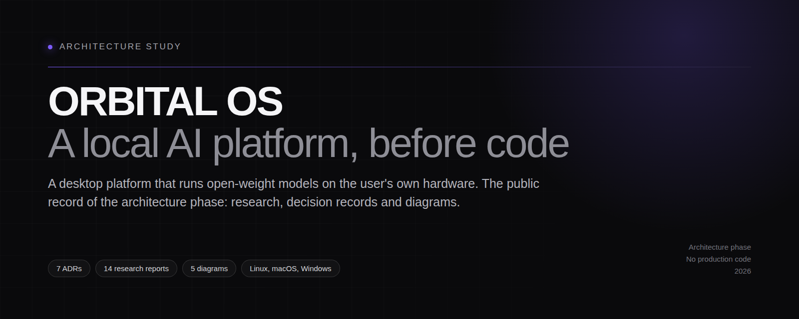
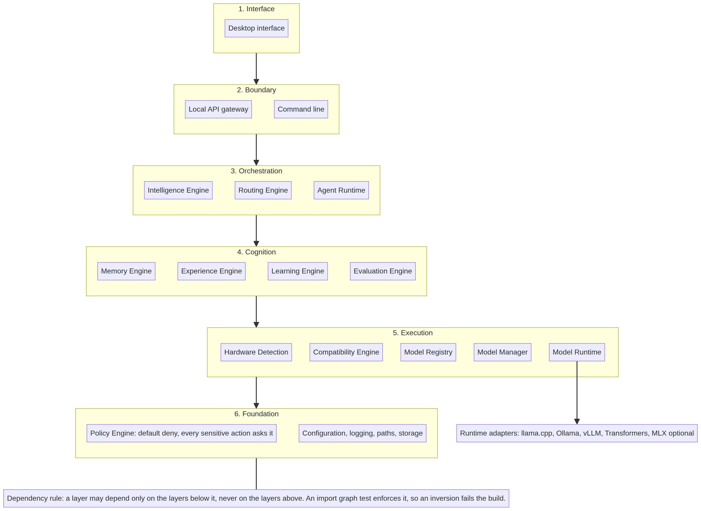

# ORBITAL OS
[English](README.md) · **Português**

Um estudo de arquitetura para uma plataforma de IA local, independente de hardware, entregue como aplicativo desktop.



ORBITAL OS é um produto real, hoje em fase de arquitetura, feito para a linha de hardware ORBITAL e também
para máquinas comuns com AMD, NVIDIA, Intel ou apenas CPU. Este repositório é o registro público dessa fase:
pesquisa, arquitetura, registros de decisão e diagramas. Não há código de produção aqui, e nenhuma
compatibilidade de hardware é declarada sem teste na máquina correspondente.

## Visão geral

ORBITAL OS é uma plataforma de IA local, modular e multiplataforma, distribuída como aplicativo para Linux,
Windows e macOS. Roda modelos no hardware do usuário, com privacidade como padrão, e expõe um motor próprio
com memória persistente, registro de experiência, aprendizado contínuo, avaliação de qualidade,
gerenciamento de modelos e, mais adiante, execução multiagente. Não é um sistema operacional. É o aplicativo
que roda na linha de hardware ORBITAL, cujas máquinas se baseiam em plataformas AMD Ryzen AI Max
([orbitalzerion.com](https://www.orbitalzerion.com/en/)), e foi projetado para rodar também no hardware de
outros fabricantes. O mesmo núcleo precisa funcionar em AMD, NVIDIA, Intel e CPU pura, em três sistemas
operacionais, com o runtime de inferência que melhor servir à máquina à frente do usuário.

Este estudo se dirige a engenheiros e revisores técnicos que querem ver como um produto de inferência
independente de hardware é especificado antes de existir código: quais afirmações são demonstráveis, quais
vêm emprestadas de terceiros e quais seguem sem verificação. Estado no encerramento da fase de arquitetura:
57 arquivos, cerca de 4.000 linhas de documentação, 14 relatórios de pesquisa, 7 registros de decisão e
5 diagramas. Nenhum código de produção. Nenhuma compatibilidade declarada sem teste de hardware.

## O problema

Antes de executar qualquer coisa, um produto de inferência local precisa responder a três perguntas: que
hardware está de fato presente, qual runtime consegue usar esse hardware e se um determinado modelo cabe na
memória. Para cada uma existe uma resposta fácil de entregar e errada.

Quem descreve o hardware é a folha de marketing, não o sistema operacional. A página do fabricante pode
anunciar um teto de memória enquanto a máquina na bancada reporta outro, e benchmark público costuma sair em
configuração diferente da que está à venda. Software que confia na especificação erra dos dois lados: ou
recusa um modelo que caberia, ou aceita um modelo que esgota a memória no meio da conversa. Na aceleração, a
armadilha é a mesma: nome de dispositivo não é capacidade, e um número nominal de TOPS não diz se um modelo
naquele formato consegue executar na unidade.

Os runtimes também estão fragmentados. Nenhum cobre AMD, NVIDIA, Intel, Apple e CPU pura em Linux, Windows e
macOS com as mesmas garantias, e cada um é forte em um canto diferente. Amarrar o produto a um único runtime
é amarrá-lo ao roadmap de um único fornecedor.

Por fim, o recurso que torna o produto interessante é justamente o que tem mais chance de quebrar a
confiança. Implementado como treinamento sobre o modelo base, "aprender com o seu uso" tira três coisas de
uma vez: reverter, apagar e explicar por que o sistema mudou de comportamento.

## O que o produto faz

**Avaliar a máquina e o modelo.** A detecção de hardware levanta sistema operacional, CPU, dispositivos
gráficos, memória e bibliotecas de aceleração, e depois roda um teste funcional curto em cada API de
aceleração, em vez de confiar no nome do dispositivo. O motor de compatibilidade converte esse inventário em
um orçamento de memória e em um entre seis estados explícitos por modelo, de testado a incompatível.

**Adquirir e executar modelos.** O registro separa descoberta, instalação e execução, e cada campo de
metadados carrega proveniência. O gerenciador de modelos baixa de fontes oficiais com verificação de
checksum, e uma camada de runtime universal executa o artefato pelo adaptador que servir à máquina.

**Lembrar.** O motor de memória guarda memórias episódicas, semânticas, procedurais e de preferência em
armazenamento local, com recuperação híbrida, rastreamento de origem, retenção configurável e exclusão que
chega a todo artefato derivado.

**Melhorar, com um gate.** O aprendizado rápido mexe apenas em artefatos reversíveis: preferências,
instruções de contexto, procedimentos e roteamento. O aprendizado profundo gera adaptadores versionados sobre
um modelo base congelado, compara cada um com a versão em uso e só promove quando a melhoria se demonstra. O
rollback fica disponível o tempo todo.

**Expor o motor.** O mesmo núcleo serve como biblioteca importável, ferramenta de linha de comando e API
local com um subconjunto compatível com OpenAI declarado. Assim, clientes externos e a interface desktop são
consumidores comuns.

**Agir com agentes.** Um escopo posterior acrescenta o runtime de agentes, com contratos próprios, execução de
ferramentas sob política e escolha de modelo por agente. Esta parte está especificada, não construída.

## Arquitetura



Seis camadas, quinze módulos, uma regra de dependência: uma camada só pode depender das que estão abaixo, e
uma inversão reprova a suíte de testes, não a revisão de código. Fonte: [diagrams/architecture.mmd](diagrams/architecture.mmd).

| Camada | Módulos | Responsabilidade |
| --- | --- | --- |
| Interface | Interface desktop | Apresenta o estado, coleta consentimento, nunca detém dado canônico |
| Fronteira | Gateway de API, linha de comando | Subconjunto compatível com OpenAI declarado, streaming, autenticação local |
| Orquestração | Motor de Inteligência, Motor de Roteamento, Runtime de Agentes | Interpreta a requisição, escolhe modelo e runtime, executa agentes |
| Cognição | Motor de Memória, Motor de Experiência, Motor de Aprendizado, Motor de Avaliação | Recuperação, registro seletivo, adaptadores e seu gate, pontuação |
| Execução | Detecção de Hardware, Motor de Compatibilidade, Registro de Modelos, Gerenciador de Modelos, Runtime de Modelos | Inventário, vereditos, catálogo, artefatos, adaptadores |
| Fundação | Motor de Políticas, configuração, logging, armazenamento | Decisão de negar por padrão, trilha de auditoria, persistência local |

A requisição entra pela fronteira, passa pelo motor de políticas e chega ao Motor de Inteligência, que resolve
intenção, complexidade e um orçamento de contexto. O Motor de Memória devolve o contexto consentido com a origem
anexada. O Motor de Roteamento escolhe modelo, runtime e cadeia de fallback, e para isso parte do veredito de
compatibilidade. O adaptador de runtime carrega o artefato, gera com streaming e reporta métricas. A resposta
sai pela fronteira com o registro de execução. O Motor de Experiência só registra a interação se houver
consentimento, e a fila de aprendizado fica fora do caminho da requisição. A sequência está desenhada em
[diagrams/flow.mmd](diagrams/flow.mmd).

## Destaques de engenharia

### Dimensionar o modelo pela memória que o runtime reporta

O problema: documentação de fabricante, artigo de benchmark e a máquina à frente do usuário discordam sobre
quanta memória existe, e um modelo aceito no papel pode esgotar a memória durante a geração. A decisão: o
motor de compatibilidade dimensiona cada candidato contra a memória que o sistema operacional reporta em
tempo de execução, somada ao resultado de um teste funcional por API de aceleração. Especificação nominal
nunca entra na conta. O orçamento é explícito: pesos residentes a partir do total de parâmetros e dos bits
efetivos por peso, KV cache a partir dos metadados de camada e de cabeça do próprio artefato, espaço de
scratch, e uma reserva de 20 a 25 por cento da memória para o sistema, mais 10 a 15 por cento do orçamento de
inferência para overhead. O veredito é um entre seis estados, e só um teste de ambiente registrado produz
"testado". O trade-off: o software continua correto em hardware que ninguém qualificou, e por isso responde
"compatível, não validado" onde uma página de marketing preferiria "suportado". O produto não pode prometer
que um modelo roda numa máquina que nunca viu, porque a resposta honesta depende da memória que aquela
unidade reporta.

### Um núcleo, vários runtimes, com capacidades declaradas

O problema: nenhum runtime cobre AMD, NVIDIA, Intel, Apple e CPU em três sistemas operacionais, e envolver a
aplicação em torno de um deles importa os limites daquele fornecedor para dentro do produto. A decisão: um
contrato de runtime com descoberta, instalação, carga, configuração, geração, embedding, status, métricas e
diagnóstico, implementado uma vez por adaptador para llama.cpp, Ollama, vLLM, Transformers e, opcionalmente,
MLX. Cada método declara suas capacidades. Se um adaptador não consegue implementar um método com fidelidade,
ele declara a limitação e a chamada falha com erro explícito; simular o comportamento conta como falha de teste.
Quem escolhe é o motor de roteamento, com o veredito de compatibilidade como entrada, nunca o chamador. O
trade-off: cada adaptador carrega a própria matriz de validação por sistema operacional, backend e
dispositivo, então o custo de manutenção cresce com o número de adaptadores mantidos vivos. Uma lista curta
de adaptadores bem testados vale mais que cobertura nominal ampla, e adaptador que ninguém testa é desativado,
não remendado dentro do contrato.

### Aprendizado que não corrompe o modelo base

O problema: "aprende com você" implementado como treinamento sobre o modelo base destrói rollback, exclusão e
auditabilidade, e ainda degrada em silêncio. A decisão: duas camadas com privilégios diferentes. O
aprendizado rápido grava apenas artefatos reversíveis e legíveis por humanos: preferências, instruções de
contexto, memórias, procedimentos e configuração de roteamento. O aprendizado profundo produz adaptadores
LoRA, QLoRA ou DoRA sobre uma base congelada. Treina em isolamento, a partir de um dataset versionado e
imutável, mede antes e depois com comparação pareada e só promove quando a melhoria se demonstra. Todo
adaptador tem linhagem, histórico de versões, ponteiro para a versão corrente e para a anterior, e rollback.
Promoção automática é proibida por padrão. O trade-off: o ganho possível é limitado pelo que os adaptadores
entregam, e o Motor de Avaliação deixa de ser acessório para virar pré-requisito. Uma interação isolada nunca
causa mudança permanente, o que torna o produto mais lento para se adaptar do que a promessa sugere. A
exclusão também precisa chegar aos adaptadores derivados, não só ao texto guardado.

### Negar por padrão na autonomia local

O problema: agentes e ferramentas rodam com as credenciais do próprio usuário, na máquina do próprio usuário.
Um padrão permissivo, nesse cenário, é escalada de privilégio local esperando uma descrição de ferramenta
malfeita. A decisão: o motor de políticas fica na camada de fundação e toda ação sensível passa por ele. O
padrão é negar, o privilégio é mínimo, a herança nunca amplifica, cada aprovação vincula payload, recurso,
ferramenta e validade, e a trilha de auditoria é append-only e admite revogação. O isolamento usa o que cada
sistema operacional de fato oferece: seccomp com Landlock, AppContainer com job objects ou App Sandbox.
Quando a plataforma não entrega a proteção pedida, a operação falha em modo fail closed, com mensagem visível. MCP
é fronteira de interoperabilidade, não autoridade de confiança. O trade-off: mais pedidos de aprovação,
recursos indisponíveis em plataformas sem a primitiva de isolamento, e a interface obrigada a declarar qual
proteção foi aplicada de verdade, não qual era a pretendida.

## Stack tecnológico

| Camada | Escolha | Por quê |
| --- | --- | --- |
| Linguagem do núcleo | Python 3.12 com uv | Único ecossistema com integrações funcionais de llama.cpp, Ollama, vLLM, Transformers e PEFT |
| Contratos | pydantic v2, esquemas versionados | Um tipo validado em cada borda de módulo elimina uma classe inteira de erro de integração |
| Persistência | SQLite em modo WAL com FTS5 | Zero operação, transacional, backup no nível do arquivo, exclusão auditável |
| Índice vetorial | Plugável atrás de interface interna | sqlite-vec, LanceDB embarcado e busca exata são comparados por benchmark local, não por reputação |
| Runtime principal | llama.cpp, release estável fixada, Vulkan primeiro | Cobre CPU, CUDA, HIP, Vulkan e Metal com uma família de binários e artefatos GGUF |
| Runtimes adicionais | Ollama, vLLM, Transformers, MLX só em Apple | Cada um cobre um perfil que o runtime principal atende mal |
| Aprendizado | PEFT e TRL para LoRA, QLoRA e DoRA | Caminho documentado do treino do adaptador até um adaptador GGUF servível |
| API local | FastAPI com subconjunto OpenAI declarado | Cliente externo funciona sem camada de tradução, streaming incluído |
| Isolamento | seccomp e Landlock, AppContainer, App Sandbox | Primitivas nativas por plataforma, com capacidades declaradas e fail closed |
| Shell desktop | Tauri 2 com o motor como sidecar, proposto | Depende de um protótipo medido nos três sistemas operacionais, não de reputação |
| Distribuição | Wheel do motor mais sidecars por sistema operacional, matriz de CI nativa, atualizador assinado | PyInstaller não é compilador cruzado, então cada plataforma compila no próprio runner |

## Em números

| Métrica | Valor |
| --- | --- |
| Arquivos no repositório no encerramento da fase de arquitetura | 57 |
| Linhas de documentação | aproximadamente 4.000 |
| Relatórios de pesquisa com fontes primárias | 14 |
| Registros de decisão de arquitetura | 7 |
| Diagramas, fonte Mermaid mais PNG renderizado | 5 |
| Commits | 5 |
| Scripts Python auxiliares (calculadora de memória, gate de entrega) | 2 |
| Código de produção | 0 |

As contagens descrevem o repositório privado de trabalho ao final da fase de arquitetura. Este repositório
público traz dois dos cinco diagramas, os registros de decisão em forma condensada e três exemplos escritos
para publicação. As contagens aparecem porque são verificáveis, não porque volume seja virtude: o que ficou
de útil naquela fase é o conjunto de decisões, e várias delas são correções.

## Segurança e privacidade

O que o projeto especifica, em decisões de acesso: motor de políticas com negar por padrão, privilégio
mínimo e herança que não amplifica; isolamento de capacidades por sistema operacional, com declaração
explícita do que foi aplicado. Do lado dos dados: consentimento por finalidade para captura de memória,
avaliação e treinamento, revogável e com efeito sobre o uso novo; auditoria append-only das ações sensíveis,
com revogação; fronteira local, em que nada sai do host sem ação nomeada, explícita e auditada; API presa ao
loopback, com autenticação mesmo na mesma máquina, chaves guardadas como verificadores em vez de texto puro,
e nenhum segredo anunciado na descoberta de rede.

O que explicitamente não está garantido nesta fase: nada disso está implementado, então nada disso serve de
base de confiança. Não existe software rodando para atacar, nem postura de segurança para testar. O
isolamento depende da versão e da configuração do sistema operacional realmente presentes, e o projeto exige
que o produto reporte proteção reduzida em vez de aceitar o rebaixamento em silêncio. Dependências de
terceiros, licenças de modelo e termos de redistribuição de runtime são revisados item a item e não entram em
nenhuma declaração genérica aqui.

## Escopo deste repositório

Publicado: as conclusões da pesquisa com suas fontes, a arquitetura e seus contratos, os sete registros de
decisão em forma condensada, o modelo de segurança, os dois diagramas que sustentam o argumento e três
exemplos pequenos que demonstram técnica.

Omitido de propósito: o corpus de pesquisa do produto na íntegra, os termos comerciais de hardware, as
alegações de desempenho do cliente, que aparecem apenas como declarações de terceiros atribuídas,
identificadores internos e detalhes de infraestrutura, o material de referência visual fornecido pelo cliente
e qualquer implementação. Implementação não há para omitir: a fase de arquitetura produziu documentos, não
software. Os exemplos deste repositório foram escritos do zero para publicação e não compartilham código com
o trabalho privado.

## Mapa do repositório

```
orbital-os/
├── README.md
├── LICENSE
├── .gitignore
├── docs/
│   ├── banner.png           banner do repositório
│   ├── ARCHITECTURE.md      camadas, contratos, fluxo da requisição, modelo de dados, limites
│   ├── DECISIONS.md         sete registros de decisão
│   ├── CASE-STUDY.md        como desenhar a estratégia de runtime antes de escrever código
│   └── SECURITY.md          ativos, fronteiras, ameaças, controles, lacunas
├── diagrams/
│   ├── architecture.mmd     seis camadas e a regra de dependência
│   ├── architecture.png
│   ├── flow.mmd             uma requisição por roteamento, runtime, memória, avaliação
│   └── flow.png
└── examples/
    ├── README.md
    ├── runtime_contract.py  contrato de adaptador com capacidades declaradas
    ├── memory_fit.py        encaixe do modelo contra a memória reportada
    └── adapter_gate.py      máquina de estados de promoção e rollback
```

## Documentação

- [Arquitetura](docs/pt-BR/ARQUITETURA.md)
- [Decisões](docs/pt-BR/DECISOES.md)
- [Estudo de caso](docs/pt-BR/ESTUDO-DE-CASO.md)
- [Segurança e privacidade](docs/pt-BR/SEGURANCA.md)
- [English](README.md)

## Autor

Hay Beaumont, engenheiro de software, [github.com/yahbeaumont](https://github.com/yahbeaumont).
